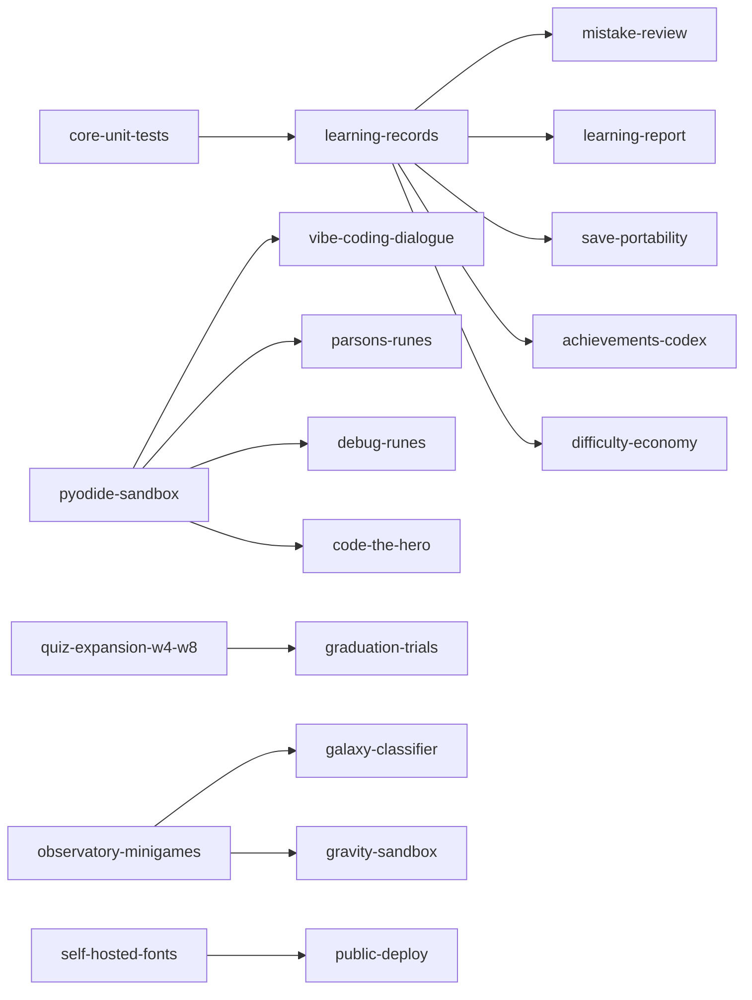

# PyQuest Backlog 总览

> 本目录是项目的本地 issue tracker（约定见 `docs/agents/issue-tracker.md`）：
> 每个 effort 一个目录 = `spec.md`（规格）+ `issues/NN-*.md`（一张工单一个文件，按依赖顺序编号）。
> 2026-10-25 建立：33 个 effort · 193 张工单。设计依据与参考的教学研究 / 教育产品见 [`INSPIRATION.md`](INSPIRATION.md)。

## 怎么读

- **spec 的 Status 全部是 `needs-triage`**：规格是起草稿，等维护者（助教）审过再定。
- **工单 Status**：`ready-for-agent` 规格清楚可直接开工 · `ready-for-human` 需要人拍板 / 提供素材（多为 grilling 工单）·
  `needs-info` 被某个拍板工单挡住 · 完成后改 `resolved` 并在 Comments 里写结论。
- **Blocked by**：同目录写编号，跨 effort 写相对路径；所有阻塞都已校验可解析、无环。
- 每个 spec 都有「待决策」小节：每条都给了推荐选项和理由，助教可以直接选「按推荐」。

## 正在实现（第一波，分支在 fork 上）

| 分支 | 对应 effort | 说明 |
| --- | --- | --- |
| `fix/highlight-strings` | custom-quiz-packs/01 | **已推送**：修复代码高亮破坏字符串字面量（54 题题面出现可见残片 `str">`） |
| `feat/boss-mechanics` | boss-signature-mechanics | 11 个 BOSS 各一个与本章知识点呼应的招牌机制 |
| `feat/python-secrets` | world-secrets | 各章野外的 Python 文化彩蛋（`import this`、`import antigravity`…）+ 秘藏计数 |
| `feat/chiptune-music` | chiptune-music | 零素材程序化背景音乐，答题时自动压低 |
| `feat/observatory` | observatory-minigames | 第八章 NFW 拟合台、第七章频率调谐台 |
| `feat/mobile-touch` | mobile-touch-controls | 虚拟摇杆 + 触控按钮（upstream 路线图） |
| `feat/mistake-book` | learning-records + mistake-review | 作答记录（含答错）+ 错题本复习 |

第一波实现**先按各 spec「待决策」的推荐方案落地**；对应的 grilling 工单仍保留，助教确认后如有调整再改。

## 全部 effort

### 教学新题型（借鉴教学研究）

| P | effort | 一句话 | 工单 |
| --- | --- | --- | --- |
| P1 | [parsons-runes](parsons-runes/spec.md) | 代码拼图：把题库里已校验代码的打乱行排回去（Parsons problems） | 5 |
| P1 | [code-trace-replay](code-trace-replay/spec.md) | 答完题「看它怎么跑」：逐行回放 + 变量表 + 中文解释（PRIMM / Python Tutor） | 5 |
| P1 | [pyodide-sandbox](pyodide-sandbox/spec.md) | 浏览器里真跑 Python 判分（upstream 路线图） | 7 |
| P2 | [debug-runes](debug-runes/spec.md) | 找 bug 符文：先定位再修复，目标写成测试用例（Gidget） | 5 |
| P2 | [code-the-hero](code-the-hero/spec.md) | 写真 Python 驱动勇者过解谜房（CodeCombat / The Farmer Was Replaced） | 6 |
| P2 | [vibe-coding-dialogue](vibe-coding-dialogue/spec.md) | 第十章对话式编程：在模拟 AI 对话里练「验证」（upstream 第二部规划） | 5 |

### 学习数据与复习

| P | effort | 一句话 | 工单 |
| --- | --- | --- | --- |
| P1 | [learning-records](learning-records/spec.md) | 作答记录（答对 / 答错 / 放弃）+ 存档 v3 | 4 |
| P1 | [mistake-review](mistake-review/spec.md) | 错题本与复习模式 | 5 |
| P1 | [learning-report](learning-report/spec.md) | 学习报告：学生自查、交给老师、班级汇总（无后端） | 5 |
| P2 | [save-portability](save-portability/spec.md) | 存档导出 / 导入（换电脑、清缓存前备份） | 4 |
| P2 | [placement-test](placement-test/spec.md) | 摸底测试：有基础的学生跳过入门章（Duolingo 式定位） | 5 |

### 课堂与助教

| P | effort | 一句话 | 工单 |
| --- | --- | --- | --- |
| P1 | [classroom-mode](classroom-mode/spec.md) | 课堂投屏：Peer Instruction 两轮投票 + 全班 BOSS 战，不需要服务器和学生设备 | 7 |
| P2 | [custom-quiz-packs](custom-quiz-packs/spec.md) | 助教自定义题包（JSON 导入成「练习场」） | 6 |

### 好玩的玩法

| P | effort | 一句话 | 工单 |
| --- | --- | --- | --- |
| P2 | [boss-signature-mechanics](boss-signature-mechanics/spec.md) | 11 个 BOSS 的招牌机制（频率分身、梯度下降冲锋、幻觉符文……） | 7 |
| P2 | [world-secrets](world-secrets/spec.md) | 隐藏秘藏 + Python 彩蛋 | 6 |
| P2 | [observatory-minigames](observatory-minigames/spec.md) | 观测站小游戏：NFW 拟合、光变找周期、并行搬砖、蒙特卡洛 π、FITS 拉伸… | 7 |
| P2 | [galaxy-classifier](galaxy-classifier/spec.md) | 星系分类台：先当分类员，再训练分类器、看混淆矩阵（Galaxy Zoo） | 6 |
| P2 | [gravity-sandbox](gravity-sandbox/spec.md) | 引力沙盒：亲手摆 N-body，看 softening 与步长的影响（Universe Sandbox） | 6 |
| P2 | [achievements-codex](achievements-codex/spec.md) | 知识卡图鉴 + BOSS 图鉴 + 成就（不鼓励刷题和乱猜） | 6 |
| P2 | [challenge-modes](challenge-modes/spec.md) | 每日星图 / 限时试炼 / 硬核 / 二周目 | 5 |
| P2 | [difficulty-economy](difficulty-economy/spec.md) | 爱心成长、金币与商店、难度档位（upstream 路线图） | 6 |
| P3 | [chiptune-music](chiptune-music/spec.md) | 程序化背景音乐与音频设置 | 5 |
| P3 | [story-and-companions](story-and-companions/spec.md) | 贯穿两部的主线剧情 + 随行伙伴 | 6 |

### 内容扩充（受 ADR-0001 约束：题面以讲义为准）

| P | effort | 一句话 | 工单 |
| --- | --- | --- | --- |
| P2 | [quiz-expansion-w4-w8](quiz-expansion-w4-w8/spec.md) | W4-W8 每章 20 → 40-60 题（upstream 路线图） | 7 |
| P2 | [graduation-trials](graduation-trials/spec.md) | 八个课程 Project 的通关后隐藏关卡（upstream 路线图「毕业试炼」，建议改名避免与第十一章撞名） | 6 |

### 可达性与发布

| P | effort | 一句话 | 工单 |
| --- | --- | --- | --- |
| P0 | [self-hosted-fonts](self-hosted-fonts/spec.md) | 字体本地化：去掉 Google Fonts / jsdelivr（国内学生常加载不到） | 5 |
| P1 | [mobile-touch-controls](mobile-touch-controls/spec.md) | 移动端虚拟摇杆与触控（upstream 路线图） | 7 |
| P1 | [accessibility](accessibility/spec.md) | 无障碍与设置面板（目前全页只有 1 处 aria 属性） | 6 |
| P2 | [public-deploy](public-deploy/spec.md) | 公开部署：学生打开链接就能玩（先核实 Tiny Swords 许可证） | 6 |
| P3 | [bundle-performance](bundle-performance/spec.md) | 拆包、素材瘦身、首屏加载进度 | 6 |

### 工程质量

| P | effort | 一句话 | 工单 |
| --- | --- | --- | --- |
| P0 | [core-unit-tests](core-unit-tests/spec.md) | vitest 单元测试层：抽题 / 存档迁移 / 章内阶段 | 5 |
| P0 | [quiz-bank-lint](quiz-bank-lint/spec.md) | 题库静态校验：schema、跨章引用核对、verify-quiz 覆盖率、答案位置偏置 | 7 |
| P3 | [type-checking](type-checking/spec.md) | JSDoc 类型检查渐进引入 | 7 |

另有 [part2-landing](part2-landing/)：第二部合入时的遗留（讲解文本问题、工程遗留项、向 upstream 提 PR 的建议）。

## 依赖关系（effort 级，硬依赖）

注：parsons-runes / debug-runes 只依赖 pyodide-sandbox 的 01 号「题型分派」prefactor，不需要 Pyodide 本身。

## 需要助教拍板的事（31 张 `ready-for-human`）

最能解锁后续工作的几件，建议先看：

1. **[课程素材](quiz-expansion-w4-w8/issues/01-obtain-course-materials.md)**：2026 版讲义与八个 Project 只在原作者的 Mac 上。
   你作为助教如果有素材，题量扩充、Project 秘境、FITS 小游戏、代码符文内容就都能开工。
2. **[答案位置偏置](quiz-bank-lint/issues/06-answer-position-bias-decision.md)**：251 题里 70% 的正确答案是第 1 个选项，
   133 题的正确项还是唯一最长的那个——学生可以「蒙」。建议运行时打乱选项顺序（已核实没有题目依赖选项位置）。
3. **[Tiny Swords 许可证](public-deploy/issues/01-tiny-swords-license-and-asset-strategy.md)**：决定能不能公开部署给学生直接玩。
4. **[错题本复习规则](mistake-review/issues/01-grill-review-rules.md)** 与 **[课堂模式流程](classroom-mode/issues/01-grill-classroom-flow.md)**：教学设计类，助教最有发言权。
5. **[第二部讲解文本 5 处问题](part2-landing/issues/01-quiz-explain-cross-refs.md)**。

其余按 effort 分：achievements-codex/03 · boss-signature-mechanics/02 · bundle-performance/03 · challenge-modes/03 ·
chiptune-music/03 · code-the-hero/01 · custom-quiz-packs/05 · debug-runes/01 · difficulty-economy/01 ·
galaxy-classifier/01、02 · graduation-trials/01 · gravity-sandbox/01 · learning-report/01 · observatory-minigames/01 ·
parsons-runes/02 · placement-test/01 · public-deploy/02、05 · pyodide-sandbox/03 · quiz-expansion-w4-w8/02、05 ·
story-and-companions/01 · vibe-coding-dialogue/01 · world-secrets/01。

## 起草过程中在源码里核实到的问题

这些都已写进对应 spec / 工单，这里汇总方便一眼看到：

| 问题 | 影响 | 归属 |
| --- | --- | --- |
| 代码高亮把字符串字面量弄坏 | 54 题题面多出可见的 `str">` | **已修**（`fix/highlight-strings`） |
| 70% 的正确答案在第 1 个选项 | 学生可以蒙 | quiz-bank-lint/06、07 |
| 答错最多扣到 1 心、同一符文题目不变 | 四个选项挨个试几乎没有代价 | difficulty-economy、challenge-modes、achievements-codex |
| 只记录答对，答错不留痕 | 没有错题本、没有学习报告 | learning-records（第一波实现中） |
| 第三章起的 BOSS 浮字仍写死第一、二章的名字 | 贝叶斯祭司会喊「循环之王召唤了帮手」 | boss-signature-mechanics/01 |
| 胜利页「冒险用时」包含关掉游戏的时间 | 隔天续玩用时虚高 | learning-records/03 |
| Google Fonts / jsdelivr 外链字体 | 国内网络常加载不到；画布飘字可能永久用回退字体 | self-hosted-fonts |
| Tab 被世界地图全局拦截、地图只能按 Tab 关 | 键盘焦点无法移动；触屏关不掉地图 | accessibility/01、mobile-touch-controls/05 |
| 构建产物把整个 `assets/`（含本地 Tiny Swords、未使用的 cc0）都打进去 | 公开部署会再分发素材、体积虚大 | public-deploy/03、bundle-performance/04 |
| 一次通关最多见到题库的 42%（106 个符文槽 / 251 题） | 题库扩充增加的是「同学之间的差异」，不是单人练习量 | challenge-modes、achievements-codex、quiz-expansion-w4-w8 |
| verify-quiz 只覆盖 56 道可执行题（W1-W3 只有 8 道） | 大量题目输出没被机器核对过 | quiz-bank-lint/04、05 |
